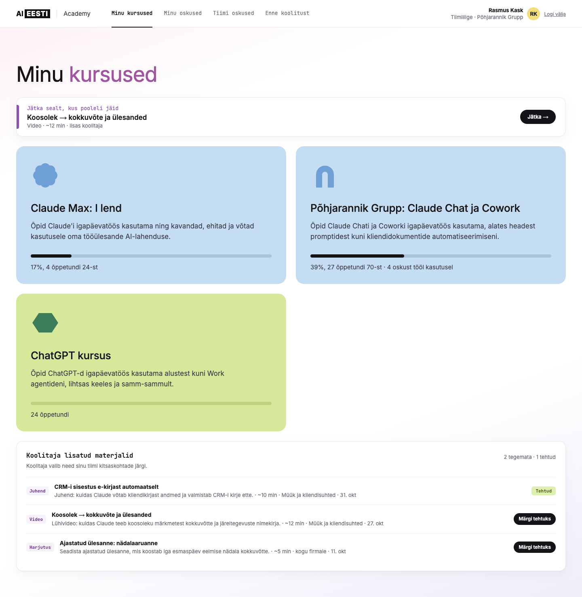
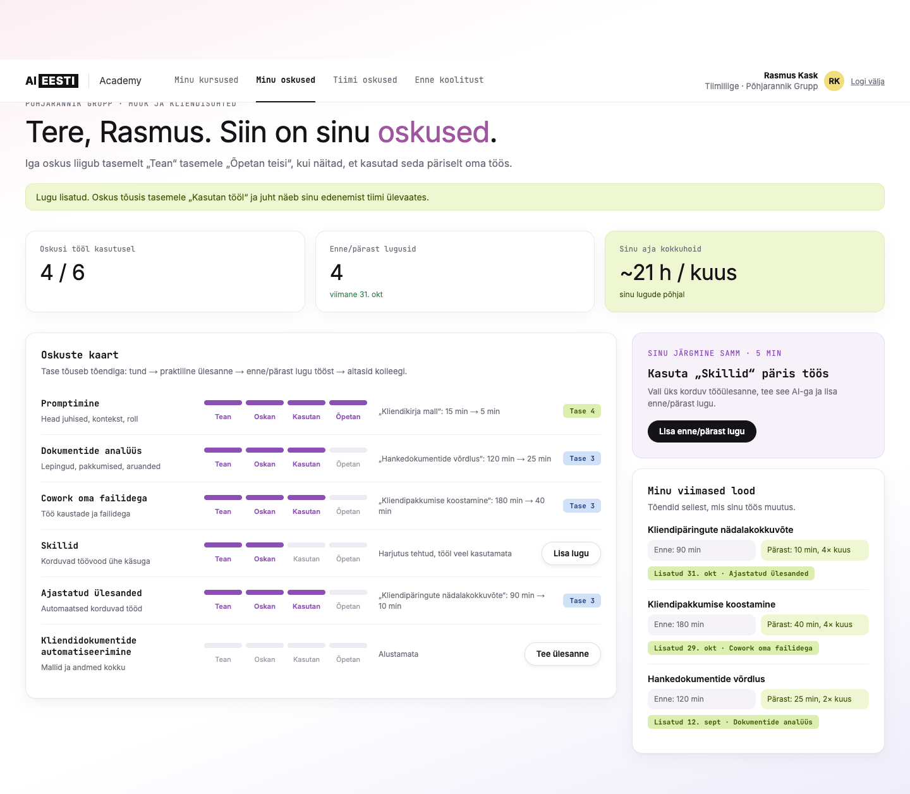
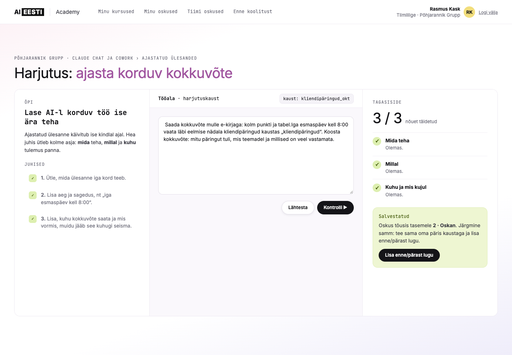
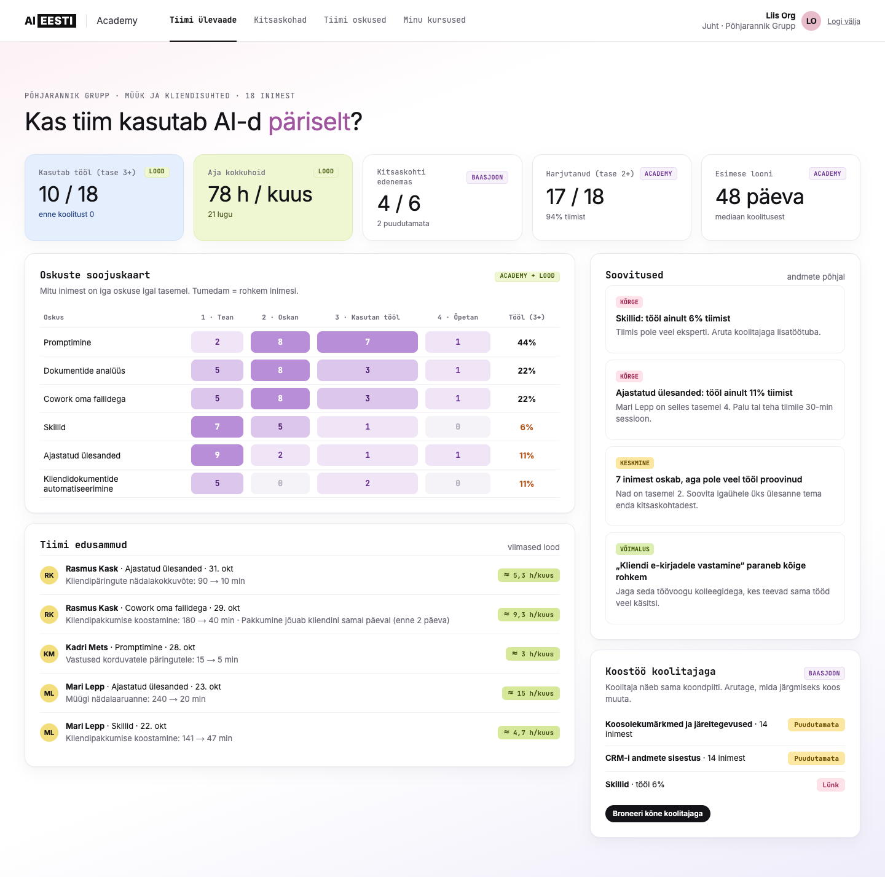
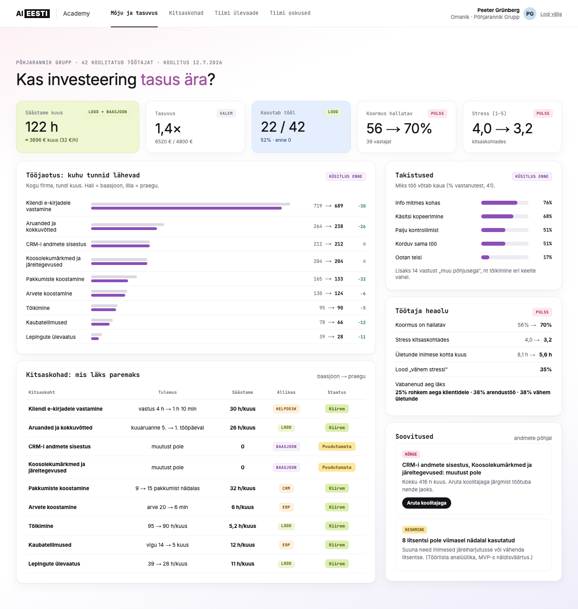
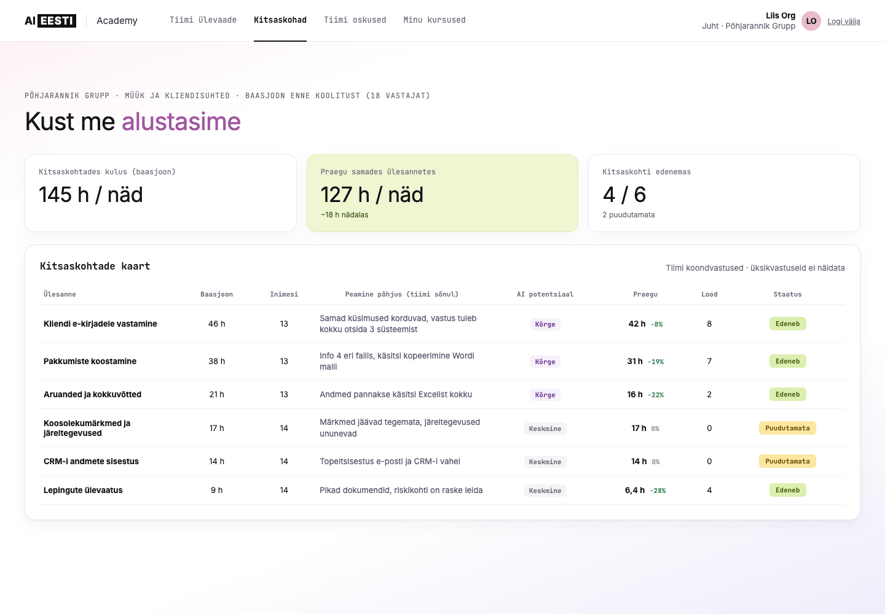
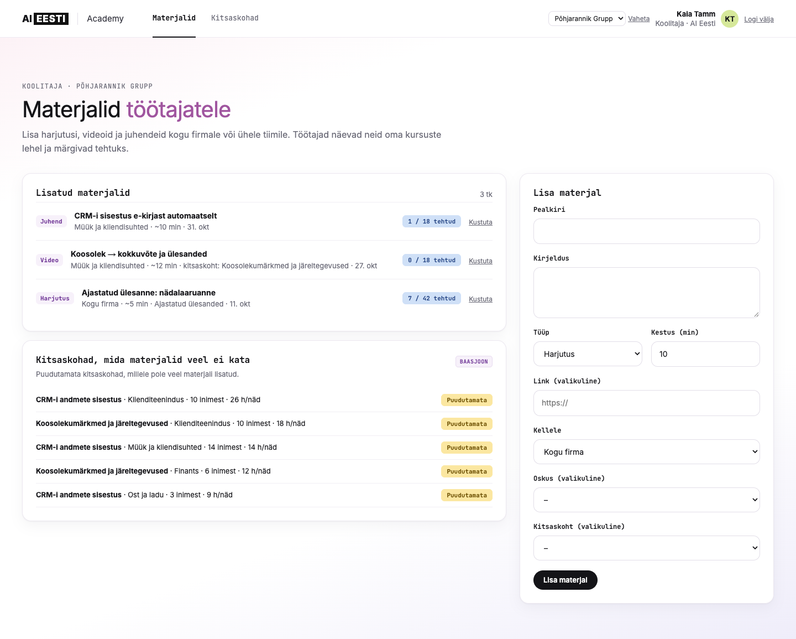
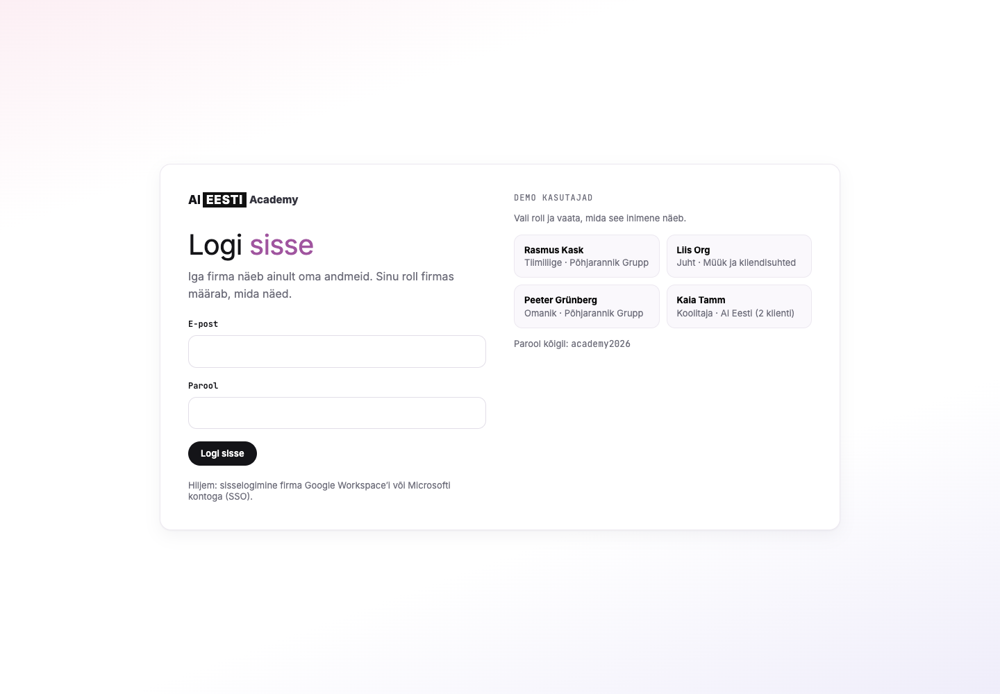

# AI Eesti Academy: oskused ja mõju (MVP)

Tootejuhi kodutöö „Koolitus sai läbi. Mis saab edasi?“ veebiversioon. Disain põhineb Figma prototüübil.

Enne koolitust kaardistatakse iga töötaja baasjoon ja kitsaskohad. Pärast koolitust näitab Academy, mis päriselt muutus:

- **Tiimiliige** näeb oma kursusi, koolitaja lisatud materjale ja oskuste kaarti, teeb harjutusi ja lisab enne/pärast lugusid.
- **Juht** näeb tiimi arengut enne ja pärast, kes mida oskab, millised kitsaskohad tiimil on ja mida koolitajaga arutada.
- **Omanik** näeb kõike, mida juht, ja lisaks säästetud aega, tasuvust, tööjaotust, takistusi ja töötajate heaolu.
- **Koolitaja** lisab materjale kogu firmale või ühele tiimile ja näeb, milliseid kitsaskohti materjalid veel ei kata.

## Käivitamine

```sh
npm install
npm run db:seed   # loob data/academy.sqlite ja näidisandmed
npm run dev       # http://localhost:3000
```

Enne käivitamist kopeeri `.env.example` failiks `.env.local` ja pane `BETTER_AUTH_SECRET` väärtuseks juhuslik pikk string (nt `openssl rand -hex 32`).

### Demo kasutajad

Parool kõigil: `academy2026`. Sisselogimise lehel on iga rolli jaoks nupp.

| Roll | E-post | Firma |
|---|---|---|
| Tiimiliige | tootaja@pohjarannik.ee | Põhjarannik Grupp |
| Juht | juht@pohjarannik.ee | Põhjarannik Grupp, Müük ja kliendisuhted |
| Omanik | omanik@pohjarannik.ee | Põhjarannik Grupp |
| Koolitaja | koolitaja@aieesti.ee | Põhjarannik Grupp ja Kaldaranna Ehitus |

Kõik numbrid on näidisandmed.

## Ekraanipildid

| Tiimiliige: minu kursused | Tiimiliige: oskuste kaart |
|---|---|
|  |  |

| Tiimiliige: harjutus | Juht: tiimi ülevaade |
|---|---|
|  |  |

| Omanik: mõju ja tasuvus | Kitsaskohtade kaart |
|---|---|
|  |  |

| Koolitaja: materjalid | Sisselogimine |
|---|---|
|  |  |

## Tehniline ülesehitus

- **Next.js 16** (App Router, server actions)
- **SQLite** (`better-sqlite3`), fail `data/academy.sqlite`
- **Better Auth** koos organisatsiooni pluginaga sisselogimiseks ja rollideks
- **Liikumine:** lehtede üleminekud Reacti `<ViewTransition>` abil (vahelehel paremale liikudes libiseb leht paremalt, vasakule liikudes vasakult) ja sujuv kerimine. Kui kasutaja süsteemis on „vähendatud liikumine“, animatsioone ei näidata.

### Organisatsioonipõhine sisselogimine

- **Organisatsioon = kliendifirma.** Kõik andmed (kursused, kitsaskohad, lood, materjalid) on firma kaupa eraldatud.
- **Tiim = osakond.** Juht näeb oma tiimi, omanik kõiki tiime.
- **Rollid** on määratud liikmesuses (`member`, `manager`, `owner`, `trainer`). Roll loetakse alati serverist (`src/lib/session.ts`) ja iga leht ning server action kontrollib seda `requireRole()` abil. URL-i muutes teise rolli vaadet ei näe.
- **Koolitaja** võib kuuluda mitmesse kliendifirmasse ja vahetab nende vahel ülaribal.

### Andmemudel

Better Authi tabelid: `user`, `session`, `organization`, `member`, `team`, `teamMember`, `invitation`.
Academy tabelid (`scripts/schema.sql`): `course`, `skill`, `user_skill`, `bottleneck`, `survey_response`, `story`, `pulse`, `material`, `material_done`, `org_settings`.

Kitsaskoha praegune seis arvutatakse: **baasjoon − seotud enne/pärast lugudega säästetud aeg**. Nii klapivad juhi ja omaniku numbrid alati omavahel.

## Mis on MVP-st teadlikult välja jäetud

- **SSO** firma Google Workspace'i või Microsoft Entra kontoga (`@better-auth/sso`), et töötajad liidetakse automaatselt õigesse firmasse
- Kutsete saatmine e-postiga ja liikmete haldus omaniku vaates
- AI tööriistade (Claude, ChatGPT, Copilot) kasutusanalüütika liidestus
- Helpdeski, ERP ja CRM-i andmete liidestus
- Harjutuse tagasiside AI-ga (praegu reeglipõhine kontroll)
